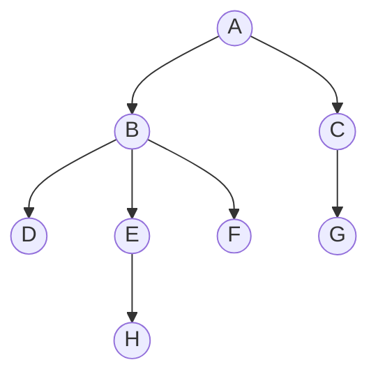
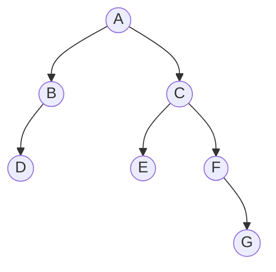
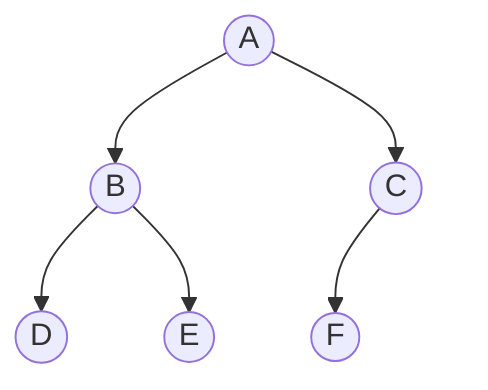

# 常见术语
以下面的树作为例子。


- **根节点**：上图中 `A` 为根节点。
- **节点的深度**：从根节点到当前节点经过的层数。上图中 `E` 的深度为 3。
- **节点的高度**：以当前节点为根节点的子树的层数。上图中 `E` 的高度为 2。
- **节点的度**：当前节点孩子的个数。上图中 `B` 的度为 3。
- **叶子节点**：度为 0 的节点。
- **分支节点**：度大于 0 的节点。
- **树的度**：树中节点的最大度数。

# 二叉树
所有节点最多只有两个孩子的树为**二叉树**，如下图为一颗二叉树。

- 存储二叉树的方法有**顺序存储**和**链式存储**。
- **顺序存储**即用一个**一维数组**来存储二叉树。从上到下，从左到右将每一个节点放入数组中，如果左孩子或右孩子为空则填入特殊值来代表，下标一般从 1 开始。
- **链式存储**即用一个**二叉链表**来存储二叉树。每个节点可以表示如下：
  ```cpp
  struct BTNode
  {
      char data;
      BTNode* lChild;
      BTNode* rChild;
      // 另外还可以添加指向父节点的指针，称为三叉链表，此时寻找父节点较方便。
      // BTNode* parent;
  }
  ```

## 完全二叉树
节点尽量紧凑且靠左的二叉树为**完全二叉树**，如下图为一颗完全二叉树。

- 使用**顺序存储**可以很方便地存储一颗完全二叉树。  
此时每个节点的父节点下标为 `(int)(index / 2)`（向下取整），子节点下标为 `index * 2` 与 `index * 2 + 1`。

## 二叉树的遍历
以下图的二叉树作为例子。二叉树均采用链式存储。

### 先序遍历
按照**根-左-右**的顺序遍历每个节点。
上图的先序遍历序列为：`A B D C E F G`。
代码实现（递归）：
```cpp
void preorder(BTNode* root, vector<char>& result)
{
    if (root == nullptr) return;

    result.push_back(root.data);
    preorder(root->lChild, result);
    preorder(root->rChild, result);
}
```

### 中序遍历
按照**左-根-右**的顺序遍历每个节点。
上图的中序遍历序列为：`D B A E C F G`。
代码实现（递归）：
```cpp
void inorder(BTNode* root, vector<char>& result)
{
    if (root == nullptr) return;

    inorder(root->lChild, result);
    result.push_back(root.data);
    inorder(root->rChild, result);
}
```

### 后序遍历
按照**左-右-根**的顺序遍历每个节点。
上图的后序遍历序列为：`D B E G F C A`。
代码实现（递归）：
```cpp
void postorder(BTNode* root, vector<char>& result)
{
    if (root == nullptr) return;

    postorder(root->lChild, result);
    postorder(root->rChild, result);
    result.push_back(root.data);
}
```

### 层序遍历
按照**每一层从左到右**的顺序遍历每个节点。
上图的层序遍历序列为：`A B C D E F G`。
代码实现（队列）：
```cpp
vector<char> levelorder(BTNode* root)
{
    vector<char> result;
    if (root == nullptr) return result;

    queue<BTNode*> q;
    q.push(root);

    while (!q.empty())
    {
        BTNode* node = q.front();
        q.pop();
        result.push_back(node->data); // 访问当前节点，并出队

        if (node->lChild != nullptr) q.push(node->lChild); // 左孩子入队
        if (node->rChild != nullptr) q.push(node->rChild); // 右孩子入队
    }
}
```

### 由遍历序列构造二叉树
- 已知**中序遍历**序列，再加上另外三种遍历序列的任意两种，即可构造唯一确定的二叉树。
- 思路：分治思想。根据**先/后/层序遍历**序列，可确定整棵树以及之后递归的每个子树的**根节点**；再根据**中序遍历**序列，可确定根节点的**左右子树**。下面以先序+中序遍历序列为例解释。
- 已知中序遍历序列为 `D B A E C F G`，先序遍历序列为 `A B D C E F G`。  
  先序遍历序列的根节点位于左侧，则可知根节点为 `A`；再根据中序遍历序列，可知左子树包含 `D B`，右子树包含 `E C F G`。  
  对于左子树，由先序遍历序列可知根节点为 `B`；再根据中序遍历序列，可知左子树包含 `D`，右子树为空。以此类推即可得出整棵树。

### 线索二叉树
- 由于二叉树中含有很多指向空节点的指针，可以将这些指针指向遍历序列的**前驱**以及**后继**来加速遍历；再用 `lTag` 和 `rTag` 来区分节点的指针指向的是子节点还是线索。  
- 对于上面的二叉树，构造先序遍历线索二叉树如下：
  
- 代码实现如下：
  ```cpp
  struct BTNode
  {
      char data;
      BTNode* lChild;
      BTNode* rChild;
      int lTag = 0;
      int rTag = 0;
  }
  BTNode* pre = nullptr;
  void preThread(BTNode* node)
  {
      if (node == nullptr) return;
      // 若当前节点的左孩子为空，建立前驱线索，指向上一个节点 pre
      if (node->lChild == nullptr)
      {
          p->lTag = 1;
          p->lChild = pre;
      }
      // 若前驱节点的右孩子为空，建立后继线索，指向下一个节点，即当前节点
      if (pre != nullptr && pre->rChild == nullptr)
      {
          pre->rTag = 1;
          pre->rChild = node;
      }
      // 更新 pre 为当前节点
      pre = node;

      if (node->lTag == 0) preThread(node->lChild);
      if (node->rTag == 0) preThread(node->rChild);
  }
  ```