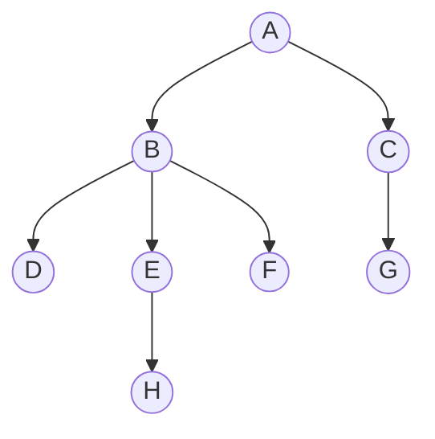
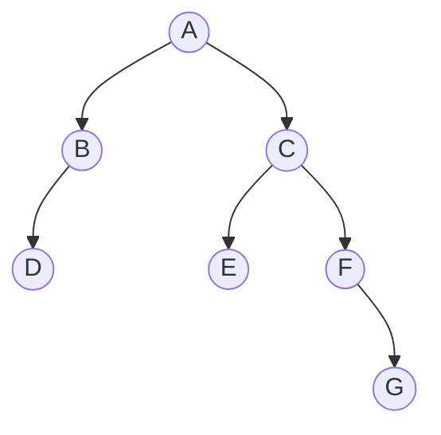
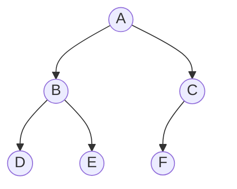

# 常见术语
以下面的树作为例子。


- **根节点**：上图中 `A` 为根节点。
- **节点的深度**：从根节点到当前节点经过的层数。上图中 `E` 的深度为 3。
- **节点的高度**：以当前节点为根节点的子树的层数。上图中 `E` 的高度为 2。
- **节点的度**：当前节点孩子的个数。上图中 `B` 的度为 3。
- **叶子节点**：度为 0 的节点。
- **分支节点**：度大于 0 的节点。
- **树的度**：树中节点的最大度数。

# 二叉树
所有节点最多只有两个孩子的树为**二叉树**，如下图为一颗二叉树。

- 存储二叉树的方法有**顺序存储**和**链式存储**。
- **顺序存储**即用一个**一维数组**来存储二叉树。从上到下，从左到右将每一个节点放入数组中，如果左孩子或右孩子为空则填入特殊值来代表，下标一般从 1 开始。
- **链式存储**即用一个**二叉链表**来存储二叉树。每个节点可以表示如下：
  ```cpp
  struct BTNode
  {
      char data;
      BTNode* lChild;
      BTNode* rChild;
      // 另外还可以添加指向父节点的指针，称为三叉链表，此时寻找父节点较方便。
      // BTNode* parent;
  }
  ```

## 完全二叉树
节点尽量紧凑且靠左的二叉树为**完全二叉树**，如下图为一颗完全二叉树。

- 使用**顺序存储**可以很方便地存储一颗完全二叉树。  
此时每个节点的父节点下标为 `(int)(index / 2)`（向下取整），子节点下标为 `index * 2` 与 `index * 2 + 1`。

## 二叉树的遍历
以下图的二叉树作为例子。二叉树均采用链式存储。

### 先序遍历
按照**根-左-右**的顺序遍历每个节点。
上图的先序遍历序列为：`A B D C E F G`。
代码实现（递归）：
```cpp
void preorder(BTNode* root, vector<char>& result)
{
    if (root == nullptr) return;

    result.push_back(root.data);
    preorder(root->lChild, result);
    preorder(root->rChild, result);
}
```

### 中序遍历
按照**左-根-右**的顺序遍历每个节点。
上图的中序遍历序列为：`D B A E C F G`。
代码实现（递归）：
```cpp
void inorder(BTNode* root, vector<char>& result)
{
    if (root == nullptr) return;

    inorder(root->lChild, result);
    result.push_back(root.data);
    inorder(root->rChild, result);
}
```

### 后序遍历
按照**左-右-根**的顺序遍历每个节点。
上图的后序遍历序列为：`D B E G F C A`。
代码实现（递归）：
```cpp
void postorder(BTNode* root, vector<char>& result)
{
    if (root == nullptr) return;

    postorder(root->lChild, result);
    postorder(root->rChild, result);
    result.push_back(root.data);
}
```

### 层序遍历
按照**每一层从左到右**的顺序遍历每个节点。
上图的层序遍历序列为：`A B C D E F G`。
代码实现（队列）：
```cpp
vector<char> levelorder(BTNode* root)
{
    vector<char> result;
    if (root == nullptr) return result;

    queue<BTNode*> q;
    q.push(root);

    while (!q.empty())
    {
        BTNode* node = q.front();
        q.pop();
        result.push_back(node->data); // 访问当前节点，并出队

        if (node->lChild != nullptr) q.push(node->lChild); // 左孩子入队
        if (node->rChild != nullptr) q.push(node->rChild); // 右孩子入队
    }
}
```

### 由遍历序列构造二叉树
- 已知**中序遍历**序列，再加上另外三种遍历序列的任意两种，即可构造唯一确定的二叉树。
- 思路：分治思想。根据**先/后/层序遍历**序列，可确定整棵树以及之后递归的每个子树的**根节点**；再根据**中序遍历**序列，可确定根节点的**左右子树**。下面以先序+中序遍历序列为例解释。
- 已知中序遍历序列为 `D B A E C F G`，先序遍历序列为 `A B D C E F G`。  
  先序遍历序列的根节点位于左侧，则可知根节点为 `A`；再根据中序遍历序列，可知左子树包含 `D B`，右子树包含 `E C F G`。  
  对于左子树，由先序遍历序列可知根节点为 `B`；再根据中序遍历序列，可知左子树包含 `D`，右子树为空。以此类推即可得出整棵树。

## 线索二叉树
### 线索二叉树的构造
- 由于二叉树中含有很多指向空节点的指针，可以将这些指针指向遍历序列的**前驱**以及**后继**来加速遍历；再用 `lTag` 和 `rTag` 来区分节点的指针指向的是子节点还是线索。  
- 对于上面的二叉树，构造先序遍历线索二叉树如下：
  
- 代码实现如下：
  ```cpp
  struct BTNode
  {
      char data;
      BTNode* lChild;
      BTNode* rChild;
      int lTag = 0;
      int rTag = 0;
  }
  BTNode* pre = nullptr;
  void preThread(BTNode* node)
  {
      if (node == nullptr) return;
      // 若当前节点的左孩子为空，建立前驱线索，指向上一个节点 pre
      if (node->lChild == nullptr)
      {
          p->lTag = 1;
          p->lChild = pre;
      }
      // 若前驱节点的右孩子为空，建立后继线索，指向下一个节点，即当前节点
      if (pre != nullptr && pre->rChild == nullptr)
      {
          pre->rTag = 1;
          pre->rChild = node;
      }
      // 更新 pre 为当前节点
      pre = node;

      if (node->lTag == 0) preThread(node->lChild);
      if (node->rTag == 0) preThread(node->rChild);
  }
  ```
### 线索二叉树的遍历
下面以中序线索二叉树来举例。

- 对于上面这颗中序线索二叉树，若要寻找某节点的前驱，则：
  - 检测该节点 `lTag` 是否为 `1` （即左指针是否指向线索），
    - 若是，则左指针**直接指向前驱**。
    - 若否，则前驱位于其**左子树的最右下节点**（因为按照**左-根-右**的顺序，该节点是它左子树中最后被访问的）。
- 若要寻找某节点的后继，则：
  - 检测该节点 `rTag` 是否为 `1` （即右指针是否指向线索），
    - 若是，则右指针**直接指向后继**。
    - 若否，则后继位于其**右子树的最左下节点**（因为按照**左-根-右**的顺序，该节点是它右子树中最早被访问的）。
- 遍历该中序线索二叉树的代码实现如下。由于线索二叉树的优势在于不使用庞大的栈空间，所以代码实现不使用递归。
  ```cpp
  struct BTNode
  {
      char data;
      BTNode* lChild;
      BTNode* rChild;
      int lTag = 0;
      int rTag = 0;
  }
  // 用于寻找以节点 p 为根的子树中最早访问的节点，即最左下节点
  BTNode* first(BTNode* p)
  {
      while (p->lTag == 0) p = p->lChild;
      return p;
  }
  // 用于寻找节点的后继
  BTNode* next(BTNode* p)
  {
      if (p->rTag == 0) return first(p->rChild); // 若指向右孩子，则寻找右子树中最早访问的节点为后继
      return p->rChild; // 若指向右线索，则直接指向后继
  }
  void inorder(BTNode* root, vector<char>& result)
  {
      // 循环遍历
      for (BTNode* p = first(root); p != nullptr; p = next(p))
      {
          result.push_back(p->data);
      }
  }
  ```
- 先序、后序的遍历同理。另外，**先序线索二叉树**可以非常方便地找到**后继**，但寻找前驱的性能较差；**后序线索二叉树**可以非常方便地找到**前驱**，但寻找后继的性能较差。这点可以自己尝试推理。
# 一般树与森林
## 一般树的存储
### 双亲表示法
- 用一个**一维数组**记录每个节点的**父节点**。该数组的每个元素都包括：`data`（用于存值）和 `parent`（一个索引，父节点的下标值）。
- 适用于找父节点较多的场景，因为该存储方法找子节点需要遍历整个数组。
### 孩子表示法
- 用一个**一维链表数组**记录每个节点的**子节点**。该数组的每个元素都包括：`data`（用于存值）和 `firstChild`（一个链表，从左到右串起所有子节点）。
- 适用于找子节点较多的场景，因为该存储方法找父节点需要遍历整个数组。
- 另外，可以结合双亲表示法和孩子表示法，将数组的元素结构改为 `data`, `parent` 和 `firstChild` 三个，这样找父节点和子节点都方便。
### 孩子兄弟表示法
- 主要运用的存储结构，将一般树转换为二叉树，使用**二叉链表**来存储。
- 转换的规则为：**左孩子右兄弟**，即链表中每个节点的左指针指向**第一个子节点**，右指针指向**下一个兄弟节点**。即：
  ```cpp
  struct BTNode
  {
      char data;
      BTNode* firstChild;
      BTNode* nextSibling;
  }
  ```
- 寻找某节点的所有子节点时，只需要从二叉链表中的**左指针**指向的节点开始一直访问**右指针**指向的节点，即该节点的第一个子节点及其所有兄弟节点。
- 该存储方式寻找父节点不方便。如果需要，可以将链表改为三叉链表，增加一个 `BTNode* parent` 属性。
## 树与森林的转换
- 森林，顾名思义即多棵树的集合。
- 二叉树与一般树的转换见上，即孩子兄弟表示法的机制。
- 森林转换成二叉树，先单独将每一棵树转换为二叉树，之后再把第二棵树开始的每棵树的根节点都视为第一棵树的根节点的兄弟节点。同样用孩子兄弟表示法来转换。
## 一般树与森林的遍历
### 先根遍历
- 先访问树的根节点，再访问根节点下每棵子树的根节点，以此类推。
- 用孩子兄弟表示法存储时，遍历序列即它所对应二叉树的**先序遍历**序列。
- 森林的先序遍历同理，只是相当于将每棵树的根节点都连到一个虚拟的根节点上。
### 后根遍历
- 先访问整棵树最左下节点，访问完每棵子树再访问该子树的根节点，以此类推。
- 用孩子兄弟表示法存储时，遍历序列即它所对应二叉树的**中序遍历**序列。
- 森林的后序遍历（或称中序遍历）同理，只是相当于将每棵树的根节点都连到一个虚拟的根节点上。
# 哈夫曼树与哈夫曼编码
- 编码，即将字符串转换为一串 01 编码，对每个字符编 01 码使得字符串编出的码无歧义。
- **哈夫曼编码**即为无歧义情况下最短的一种编码。用来生成该编码的树称为**哈夫曼树**。
## 哈夫曼树的生成
哈夫曼树是一棵**二叉树**。生成过程如下。
- 取集合中**值最小**的两个，合并到同一子树该子树的根节点值为二者之和，。
  - 取出现 1 次的 `B` 与出现 1 次的 `D`。合并后的根节点值为 `2`。
- 之后每次都取值最小的两个（**未加入树的节点值**与**当前已生成子树的根节点值**都可取），重复上述操作，直到所有节点都被加入树中。左右顺序任意，习惯上将二者较小的放在左边。
- 之后叶子节点上均为集合中已有的元素，且值较小的尽量靠下。
- 例如：`{5, 29, 7, 8, 14, 23, 3, 11}`，最终生成：
  ```mermaid
  flowchart TD
  A(("(100)")) --> B(("(42)"))
  A --> C(("(58)"))
  B --> D(("(19)"))
  B --> E((23))
  D --> F(("(8)"))
  D --> G((11))
  F --> H((3))
  F --> I((5))
  C --> J((29))
  C --> K(("(29)"))
  K --> L((14))
  K --> M(("(15)"))
  M --> N((7))
  M --> O((8))
  ```
## 哈夫曼编码的生成
以字符串 `ABAACDC` 为例子。
- 首先统计字符串中每个**字符**及其出现的**次数**。字符即为节点，次数为节点的值。
  - 则 `A: 3`, `B: 1`, `C: 2`, `D: 1`。
- 然后以这些值的集合生成一棵哈夫曼树。
  ```mermaid
  flowchart TD
  A(("(7)")) --> B(("A(3)"))
  A --> C(("(4)"))
  C --> D(("C(2)"))
  C --> E(("(2)"))
  E --> F(("B(1)"))
  E --> G(("D(1)"))
  ```
- 从根节点开始，向左指针走一步为 0，向右指针走一步为 1。
  - 上面的编码为 `A: 0`, `B: 110`, `C: 10`, `D: 111`。